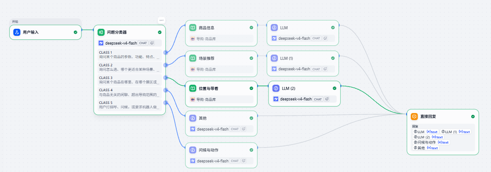
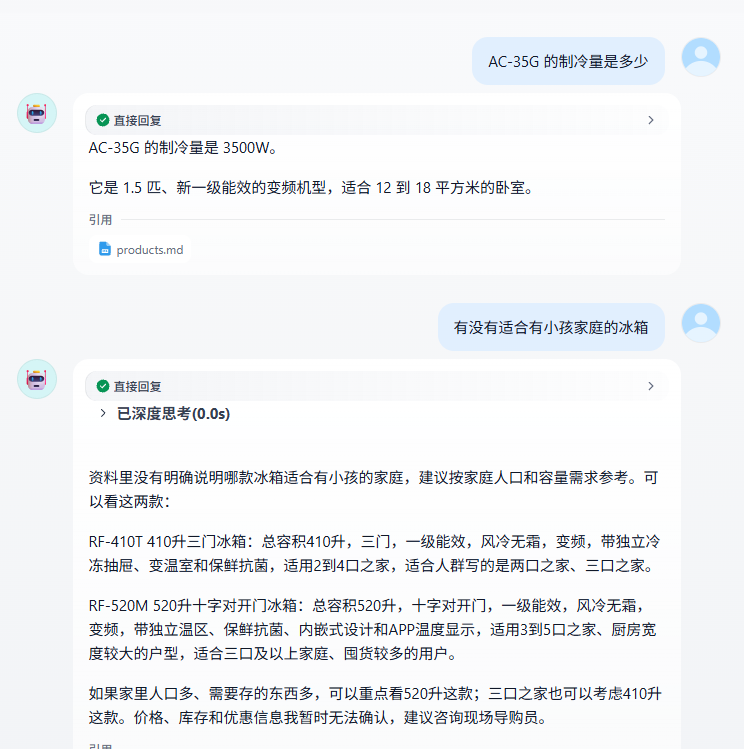
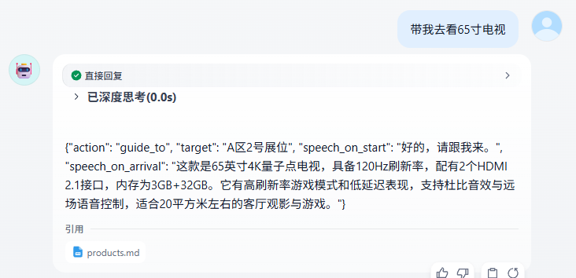

# 智能导购问答机器人（Dify Chatflow + RAG）

基于 Dify 搭建的家电导购问答机器人。能回答商品参数、按场景推荐商品、告知商品展区位置，并对"带看""打招呼""握手"这类请求输出结构化动作指令。商品数据为自建的模拟数据，动作指令没有接入真机。

## 项目背景

家电卖场里顾客的提问集中在三类：某款商品参数如何、什么场景该买什么、东西摆在哪里。前两类靠知识库检索能答，第三类需要机器人真的"带路"。

这个项目是上述场景的对话侧原型：用 Dify 搭一条「分类 → 检索 → 生成」的 Chatflow，把顾客的话分流到不同分支；需要动作时输出结构化 JSON 指令，交给下位机执行。机器人本体和地图导航部分不在本项目范围内。

## 功能

| 类型 | 说明 | 输出 |
|---|---|---|
| 商品信息 | 询问某个商品的参数、功能、能效等 | 文字回答 |
| 场景推荐 | 按户型、人群、使用场景推荐商品 | 文字回答，带推荐理由 |
| 位置与带看 | 询问商品在哪个展区，或要求带自己去看 | JSON 指令（`guide_to` 带看，或 `none` 仅告知位置） |
| 问候与动作 | 打招呼、自我介绍、握手、跳舞、转圈 | JSON 指令 |
| 其他 | 闲聊、超出范围的问题 | 文字回答，引导回家电相关问题 |

没有资料依据的内容（价格、库存、质保等），一律回答"暂时无法确认，建议咨询现场导购员"，不编造。

## 界面

工作流：



分类器分出 5 个分支，分类 1/2/3 各接一个知识检索节点，分类 4/5 直接进 LLM，五个分支汇总到「直接回复」。

文字回答：



带看指令：



最后一张里模型输出的是 JSON 原文，没有渲染成动作——这正是 `tools/parse_action.py` 要解决的问题。

## 输出示例

文字回答（分类 1/2/4）：

```
问：AC-35G 的制冷量是多少
答：AC-35G 的制冷量为 3500W。

问：这款冰箱多少钱
答：价格信息我这边暂时无法确认，建议咨询现场导购员。
```

动作指令（分类 3/5），带看请求返回：

```json
{
  "action": "guide_to",
  "target": "A区2号展位",
  "speech_on_start": "好的，请跟我来",
  "speech_on_arrival": "（到达后的商品介绍，内容来自知识库）"
}
```

## 技术方案

- 平台：Dify 1.17.1（本地 Docker 部署）
- 对话模型：DeepSeek（`deepseek-v4-flash`）；提示词不依赖具体模型，任意支持 JSON 输出的 Chat 模型均可替换
- 向量模型：`BAAI/bge-m3`（硅基流动）
- 知识库：18 个模拟商品，覆盖电视、空调、冰箱、洗衣机、生活家电
- 检索：混合检索，权重设置，Top K = 3，Score 阈值 = 0.4

## 流程

```
用户输入 → 问题分类器 ─┬─ 商品信息   → 知识检索 → LLM → 回复
                       ├─ 场景推荐   → 知识检索 → LLM → 回复
                       ├─ 位置与带看 → 知识检索 → LLM（输出 JSON）→ 回复
                       ├─ 其他       →            LLM → 回复
                       └─ 问候与动作 →            LLM（输出 JSON）→ 回复
```

## 设计要点

1. **按商品切分知识库**：每个商品一段（分隔符 `### 商品`），共 18 段，检索时不会混入相邻商品的内容。
2. **阈值调整**：初始阈值 0.3 时，无关商品也会被召回，调到 0.4 后过滤掉了无关结果，正常查询的结果不变。
3. **防止编造**：提示词要求只使用资料里写明的内容，资料里是"暂无信息"或没有相关内容时回答无法确认；不说某品类"一共几款"（检索只取 Top K 条，数量不可靠）。
4. **话术和动作分开输出**：动作类请求输出 JSON，话术字段只写口头内容，动作字段只能从白名单里选（`wave`、`handshake`、`dance`、`spin`、`guide_to`、`none`）。
5. **带看指令分两段话术**：`speech_on_start`（出发时说）和 `speech_on_arrival`（到达后介绍商品），介绍内容只来自知识库。

## 目录

```
shopping-guide-mvp/
├─ dsl/           Dify 导出的 Chatflow（智能导购MVP.yml）
├─ kb/            知识库原始数据（products.md）
├─ prompts/       分类描述和各分支提示词
├─ tests/         测试记录（test-record.md）
├─ tools/         JSON 指令解析与校验脚本（parse_action.py）
├─ docs/images/   界面截图
├─ LICENSE
└─ README.md
```

## 工具

`tools/parse_action.py` 用来解析机器人输出的 JSON 指令并校验格式，零依赖，Python 3.8+。

```bash
python tools/parse_action.py '{"speech": "你好", "action": "wave"}'
python tools/parse_action.py --file reply.txt
python tools/parse_action.py --demo
```

它做三件事：

1. 剥离模型回复里的 `<think>` 思考块和 Markdown 代码围栏，按括号配对截取 JSON
2. 按字段判断是带看指令（分类 3）还是动作指令（分类 5）
3. 校验动作白名单、必填字段、`guide_to` 的三个字段是否齐全、`none` 时 `speech_on_arrival` 是否留空；并检查话术里是否混入 Markdown 符号、括号，或知识库没有的价格、库存信息

输出示例：

```
类型：带看指令（分类 3）
动作：guide_to
位置：A区2号展位
出发话术：好的，请跟我来
到达话术：这款65寸电视支持4K分辨率，适合客厅使用。

校验结果：通过
```

退出码 `0` 表示通过（允许警告），`1` 表示存在错误级问题，可直接用于流水线判断。

## 如何复现

1. 本地部署 Dify（Docker），安装 DeepSeek 和硅基流动模型插件，配置各自的 API Key
2. 系统模型设置里，Embedding 选 `BAAI/bge-m3`
3. 新建知识库，上传 `kb/products.md`：分段标识符填 `### 商品`，高质量索引，混合检索，权重设置，Top K = 3，Score 阈值 = 0.4
4. 在工作室选择"导入 DSL 文件"，导入 `dsl/智能导购MVP.yml`
5. 打开导入的应用，把三个知识检索节点的知识库重新选择为刚建好的知识库，检查各 LLM 节点的模型

注意：DSL 文件不包含知识库内容和 API Key，需要按上面的步骤自己重建。

## 测试

21 条手工用例，分两阶段：阶段一 12 条测分类 1–4 的文字回答，阶段二 9 条测带看指令与动作指令。详细记录见 `tests/test-record.md`。

| 项目 | 结果 |
|---|---|
| 测试总条数 | 21 |
| 分类正确 | 20 / 21（95.2%） |
| 回答正确（分类 1/2/4，纯文本） | 12 / 12 |
| JSON 格式正确（分类 3/5） | 9 / 9 |
| 出现编造 | 0 |

唯一一条分类错误是「这款冰箱多少钱」被判为分类 4（其他），应走分类 1（商品信息）。由于知识库中没有价格，这条最终仍回答"暂时无法确认"，没有编造。

## 已知限制

- 数据是自建的模拟数据，共 18 个商品，不对应真实产品
- 动作和带看只输出指令，没有接入真机，没有实际执行；`target` 只是位置名称，真机还需要位置名称到地图坐标的对照
- 知识库没有价格、库存、质保信息，这类问题只能回答无法确认
- 模型偶尔会用中文全角引号输出 JSON，导致解析失败；提示词里已要求半角引号，`tools/parse_action.py` 也会自动归一化
- 测试题是自己设计的，数量有限，不代表真实场景下的表现

## 后续可做

- 扩充商品数量后重新测试检索表现
- 对比 Rerank 模型和权重设置的效果
- 把 `tools/parse_action.py` 的校验逻辑搬进 Dify 代码节点，在流程内直接分离话术与指令

## License

MIT，详见 [LICENSE](LICENSE)。
